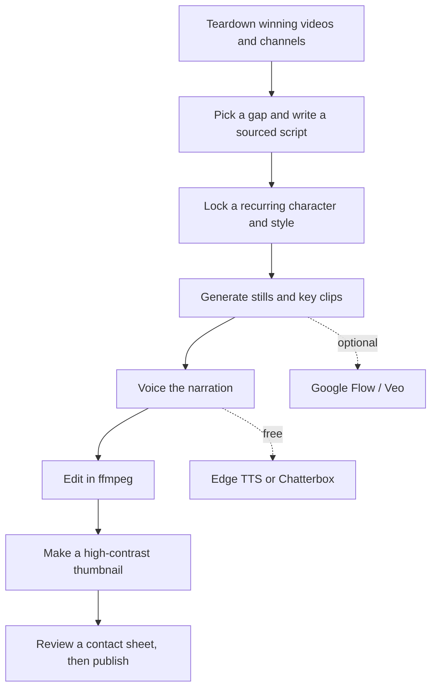
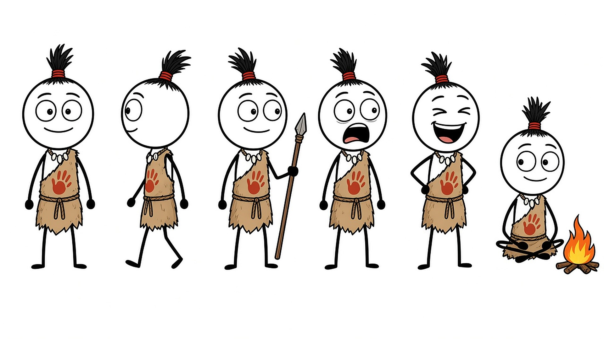
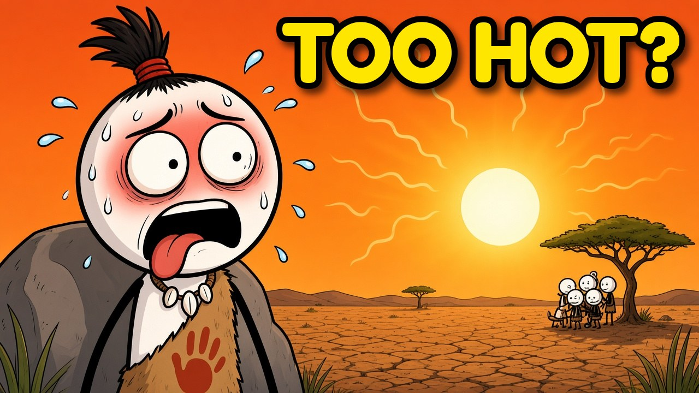
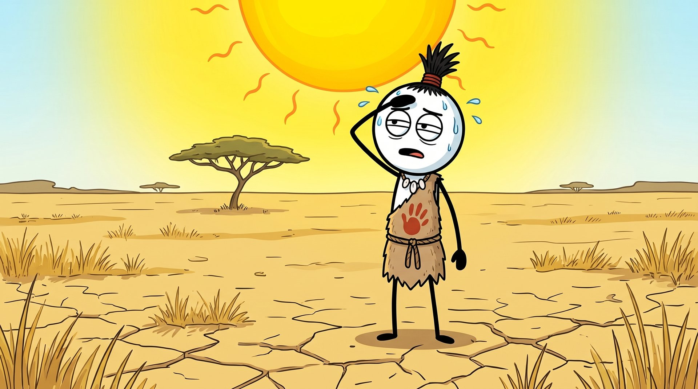
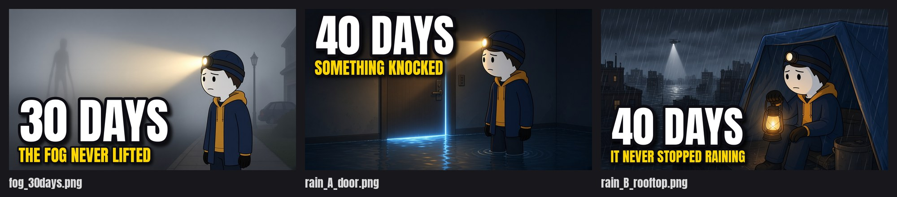

# Viral Video Creator

An AI-agent skill pack plus scripts for making faceless viral videos. Drop the skills into an agent (Claude Code, Cursor, Grok, or similar), then use the scripts to research channels, generate art, voice a script, edit, and make thumbnails.

It covers:

- **Viral teardowns** — learn why a video or channel wins (ideas and storytelling first, looks second)
- **Stickman educational explainers** — Ink Explainer-style “what it was like / what did ancient humans do when…” long-form and Shorts
- **Google Flow** — consistent characters, stills, and short animated clips (optional; needs Google AI Pro)
- **Free local voices** — Microsoft Edge neural TTS or Chatterbox, checked with Whisper
- **ffmpeg editing** and **thumbnail text overlays**
- **POV interactive horror** — first-person 2-minute episodes that end on a 2-choice cliffhanger

This is a workflow and tool kit, not a one-click autopilot. You still pick the idea, check the facts, and judge the cut.

## Quick start

```bash
git clone https://github.com/iamhirusha/viral-video-creator.git
cd viral-video-creator
python3 -m venv .venv && source .venv/bin/activate
pip install -r requirements.txt
```

1. Copy `skills/` into your agent’s skills folder (or point the agent at this repo).
2. Install the system tools below. Google AI Pro is optional and only needed for Flow.
3. Start with `viral-video-creator-getting-started`, then `viral-video-teardown` on a few channels you admire, then either `stickman-explainer-pipeline` or `pov-interactive-horror`.

```bash
# Research a channel (writes a CSV + a stats report; does not copy anyone's scripts)
python3 scripts/channel_research.py --out data/ "https://www.youtube.com/@somechannel/videos"

# Overlay huge title text on a 1280x720 thumbnail
python3 scripts/make_thumbnail.py \
  --scene your_scene.jpg --out thumb.png \
  --number "TOO HOT?" --subtitle "IT NEVER COOLED OFF" --anchor top

# Render the sample 29s POV horror episode (needs stills in scripts/pov/assets/img/ and a TTS model)
python3 scripts/pov/build.py scripts/pov/episodes/ep1_test.json
```

## Tools you need

| Tool | Used for |
|------|----------|
| **Python 3.10+** | All scripts |
| **ffmpeg** | Editing, mixing, encodes |
| **yt-dlp** | Channel research (titles, views, dates, optional auto-subs) |
| **faster-whisper** | Word timings and a pronunciation/WER check |
| **edge-tts** or **Chatterbox** (MIT) | Free local / edge voices |
| **Pillow** | Thumbnails and the POV frame renderer |
| **Google AI Pro** (optional) | Google Flow stills and Veo clips. Images on Pro do not spend monthly credits (daily caps still apply). Clips do spend credits. |
| **kokoro-onnx** (optional) | Layout-pass TTS inside `scripts/pov/build.py`. Too flat for a finished narrator. |
| **ElevenLabs** (optional paid upgrade) | If you want whispered, scared, or child voices that free tools cannot quite hit |

Also install **Anton**, **Inter**, and **Bebas Neue** (Google Fonts) for POV captions and choice cards, and a heavy rounded sans (Anton, Lilita One, or Fredoka) for thumbnails. Point the scripts at them with `FONT_DIR`:

```bash
export FONT_DIR=/path/to/your/fonts
```

F5-TTS and XTTS have **non-commercial** licences. Do not use them on a monetized channel. This repo does not ship any voice-clone reference audio.

## Workflow



**Stickman explainers.** Second-person script, present-day hook, then a flip back in time, then the title question said out loud by ~0:40. One recurring hero with 3–4 unique marks. Clean flat 2D, not painted or realistic. Hard cuts every 2–4 seconds. Thumbnails: one or two huge yellow words plus `?`, one strong reaction, one clear scene.

**POV horror.** First-person, 2:00–2:20, 9:16. The seven beats: mundane setting → ambiguous disturbance → confirmation of danger → phone UI as a second witness → threat at the door → paradox twist → 2-choice cliffhanger and “comment for Part 2”.

## Repository layout

```
skills/                  Agent skills (each folder has a SKILL.md)
  viral-video-creator-getting-started/
  viral-video-teardown/
  stickman-explainer-pipeline/
  google-flow-video-production/
  pov-interactive-horror/
scripts/
  channel_research.py    yt-dlp pull + median / pace / title-pattern analysis
  make_thumbnail.py      1280x720 text overlay + optional contact sheet
  pov/                   Vertical episode renderer, synthesized SFX, sample JSON
  voices/                Edge TTS, Chatterbox, optional F5-TTS, Whisper check
examples/                Character sheet, still, and thumbnail samples
```

## Example images

A recurring stickman hero (“Tok”: topknot, red handprint tunic, shell necklace) and a “TOO HOT?” thumbnail in the style of this pipeline:







Thumbnail typography test (number + yellow subtitle over a painted scene):



## Inspiration and what this is not

The stickman explainer path is inspired by **Ink Explainer-style stickman explainers** (and similar faceless history channels). The POV path is inspired by first-person interactive horror Shorts that end on a viewer choice.

This repository does **not** include anyone else’s scripts, transcripts, thumbnails, or voice-clone audio. Use the teardown skill to study public videos, then write original scripts and design an original character.

## License

[MIT](LICENSE) © 2026 Hirusha
